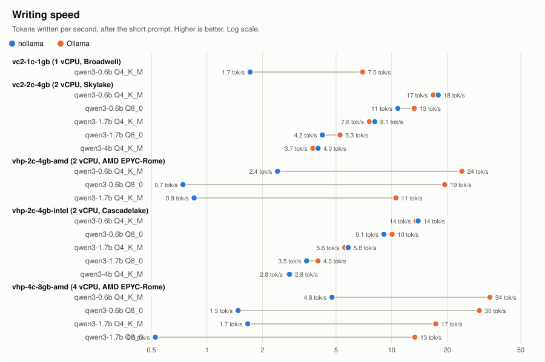
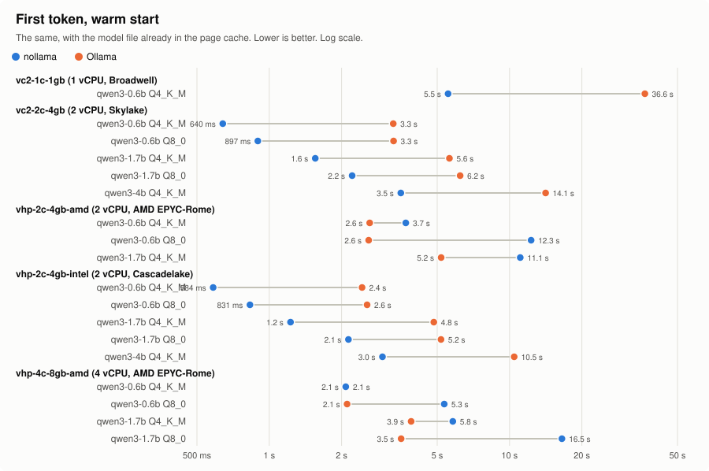

# nollama

nollama is an Ollama-compatible model server written in pure Go, which you can embed in your own Go application. The
`nollama` command line tool is meant to work as a drop-in replacement for the basic uses of Ollama: it serves Ollama's
HTTP API on the same address, it runs and pulls models with the same commands, and Ollama's own clients work with it.
The more important part of the project is the engine underneath. Because it is a Go library with no cgo, you can
compile it into your application and call it directly, instead of asking your users to install and run Ollama next to
it.

The engine runs models on the CPU, with hand-written assembly kernels for ARM64 and x86-64, and on the GPU, through
Metal on Apple Silicon and CUDA on NVIDIA cards. It uses a GPU when it finds one that works and falls back to the CPU
when it does not, with nothing extra to install in either case.

## Who it is for

### Applications that want a local model without a separate server

Instead of asking your users to install Ollama and making HTTP calls to it, you can compile nollama into your
application and make Go function calls into it. Your users install one program, the model loads in milliseconds
because the file is memory-mapped, and nothing listens on a port unless you want it to. You can also build the model
file into your binary.

### Applications that need control over inference

Some applications do not fit well behind an HTTP API. A program that scores thousands of candidate answers, explores
several continuations of the same prompt, steers each token with its own rules, or needs every machine to compute the
same probabilities spends most of its time working around a server that only answers "what comes next?". nollama lets
you do that work in your own process:

- the model's logits after every token, and the log-probability of any token or sequence (`Score`);
- a probability for each of a set of labels, without generating text (`Classify`);
- output held to a JSON schema or a tool's parameters, token by token;
- conversation state you can save, reload, rewind and fork, so several branches share the work of reading the same
  prompt (`engine.State`, experimental);
- decoding middleware for writing your own sampling and search strategies, with best-of-N and beam search built on it
  in the `x/compose` package (experimental);
- a deterministic mode in which the CPU, Metal and CUDA kernels produce the same logits, bit for bit, on every
  machine;
- integer models, whose forward pass uses integer arithmetic only, so that other implementations of the same
  specification can match nollama exactly.

### A custom inference service on a GPU machine

nollama works best when your application runs on a machine with a supported GPU. If your application cannot run
there, you can build a small service of your own with nollama, run it on a dedicated GPU machine, and give it the API
your application needs.

## Privacy

When nollama is embedded in your application, the prompts, the answers and the model's state never leave your
process. There is no separate server holding your users' conversations, no port that another program on the machine
can query unless you open one, and no telemetry. The only network requests nollama makes are model downloads from
Hugging Face, which you can avoid entirely by shipping the model file with your application or building it into the
binary. This makes nollama suitable for applications that handle private data, that must work offline, or that run
where outbound connections are not allowed.

When you run `nollama serve`, it listens on `127.0.0.1` only and refuses requests from web pages served by other
sites and requests that rely on DNS rebinding. It will not listen on a network address without an API key. The
guide's [Security](docs/guide.md#security) section describes these protections in detail.

## Install

The `nollama` command line tool installs with Homebrew on macOS and Linux:

```bash
brew install benallfree/tap/nollama
```

On Windows it installs with [Scoop](https://scoop.sh):

```powershell
scoop bucket add nollama https://github.com/benallfree/nollama
scoop install nollama
```

Without Homebrew on macOS or Linux, you can use the install script, which on Linux also sets up a systemd service:

```bash
curl -fsSL https://raw.githubusercontent.com/benallfree/nollama/main/install.sh | sh
```

Archives and Linux packages for every supported platform are on the
[releases page](https://github.com/benallfree/nollama/releases). To embed the engine, add the Go module:

```bash
go get github.com/benallfree/nollama
```

## Using it in place of Ollama

`nollama serve` listens on `127.0.0.1:11434`, the address Ollama uses, so programs written for Ollama find it without
any changes. The `ollama` command line tool works against it as well.

```bash
nollama serve
nollama run qwen3:1.7b "Write a title for a post about sourdough starters."
```

### Command line

| Ollama command | nollama | Notes |
|---|---|---|
| `ollama serve` | Yes | The same address and the same `keep_alive` behavior. |
| `ollama run` | Yes | Interactive chat or a single prompt. |
| `ollama pull` | Partly | Pulls nollama's catalog models and `hf:` files from Hugging Face, not from Ollama's registry. |
| `ollama list` | Yes | |
| `ollama rm` | Yes | |
| `ollama ps` | No | `ollama ps` itself works against `nollama serve`. |
| `ollama show` | No | `ollama show` itself works against `nollama serve`. |
| `ollama stop` | No | |
| `ollama create`, `cp`, `push` | No | nollama has no Modelfiles. |

### HTTP API

| Endpoint | nollama | Notes |
|---|---|---|
| `POST /api/chat` | Yes | Streaming, `format` (JSON or a schema), `tools`, `keep_alive`. `think` is ignored, and `images` are refused. |
| `POST /api/generate` | Yes | `raw`, `system`, `context`, `suffix`, `format`, `keep_alive`. `images` are refused. |
| `POST /api/embed` | Yes | `input`, `truncate`, `dimensions`. |
| `POST /api/embeddings` | Yes | The older embeddings endpoint. |
| `GET /api/tags` | Yes | |
| `POST /api/show` | Yes | `modelfile`, `parameters` and `template` are empty. |
| `GET /api/ps` | Yes | It reports models on the GPU as running on the CPU. |
| `POST /api/pull` | Partly | nollama's catalog models and `hf:` files only. |
| `DELETE /api/delete` | Yes | |
| `GET /api/version` | Yes | |
| `POST /api/create`, `/api/copy`, `/api/push` | No | Each answers 501. |
| `HEAD`/`POST /api/blobs/:digest` | No | |
| `options` | Partly | `temperature`, `top_p`, `top_k`, `num_predict`, `num_ctx`, `seed` and `stop` are used. Others, such as `repeat_penalty` and `min_p`, are ignored. |
| `POST /v1/chat/completions` | Yes | OpenAI's API, with streaming, `response_format`, `tools` and `tool_choice`. |
| `POST /v1/completions` | Yes | |
| `POST /v1/embeddings` | Yes | Text or token ids, `dimensions`, `encoding_format`. |
| `GET /v1/models` | Yes | |

nollama also has an endpoint of its own, `/api/classify`, which returns a probability for each of a set of labels.
The [guide](docs/guide.md) documents every endpoint and option. The server holds one model at a time and switches
models on demand.

## Supported models

The goal is to run every model in Ollama's library. This table shows where nollama stands today.

| Model family | nollama | Ollama |
|---|---|---|
| Qwen3, dense | Yes for 0.6B, 1.7B and 4B, which download by name. The larger sizes (8B, 14B, 32B) share the architecture and load from a GGUF file, but are untested. | Yes |
| Qwen3-Embedding | Yes. 0.6B downloads by name. | Yes |
| Qwen3, mixture of experts (30B-A3B, 235B-A22B) | No | Yes |
| Qwen2.5 and Qwen2.5-Coder | Only as integer models (see the [guide](docs/guide.md#integer-models-the-same-distribution-on-every-machine)) | Yes |
| Llama 3.1, 3.2 and 3.3 | No | Yes |
| Gemma 3 | No | Yes |
| Mistral and Mistral Small | No | Yes |
| Phi-4 | No | Yes |
| DeepSeek-R1 | No | Yes |
| gpt-oss | No | Yes |
| nomic-embed-text | No | Yes |
| Vision models (images as input) | No | Yes |

nollama runs Qwen3 weights in Q8_0, Q4_K_M, F16 and BF16. The models it downloads by name come from Qwen's own Hugging
Face repositories and are checked against their SHA-256. Ollama's spellings of their names, such as `qwen3:1.7b`, work
as well. The engine also contains an early, experimental Whisper speech recognizer, which the server does not expose
yet.

## Using the engine from Go

The simplest use loads a model and generates text. Here the answer is held to a JSON schema, so it always parses:

```go
import (
	"github.com/benallfree/nollama/engine"
	"github.com/benallfree/nollama/catalog"
	"github.com/benallfree/nollama/engine/schema"
)

src, _ := catalog.Resolve("qwen3-1.7b", catalog.DefaultDir())
_ = catalog.Fetch(src, nil, nil) // downloads the model once and checks its SHA-256
m, _ := engine.Load(src.Path, engine.LoadOptions{})
defer m.Close()

label, _ := schema.Compile([]byte(`{"type":"object","properties":{"label":{"enum":["bug","billing","question"]}},"required":["label"]}`))
res, _ := m.Generate(ctx, m.ChatPrompt([]engine.Message{{Role: "user", Content: "I was charged twice."}}),
	engine.GenerateOptions{MaxTokens: 30, Constraint: label.Fit}, nil)
fmt.Println(res.Text) // a JSON object whose label is one of the three
```

Going a layer lower, the experimental `engine.State` API lets you drive the model one step at a time. This example
reads a prompt once, then forks the state to measure how likely the model finds each of several answers, without
reading the prompt again for each one:

```go
st, _ := m.NewState(engine.StateOptions{})
defer st.Close()
question := "What is the capital of France? Answer in one word."
st.Step(ctx, m.Tokenize(m.ChatPrompt([]engine.Message{{Role: "user", Content: question}}))...)

for _, answer := range []string{"Paris", "Lyon", "Berlin"} {
	f, _ := st.Fork()
	logits, total := st.Logits(), 0.0
	for _, tok := range m.Tokenize(answer) {
		total += m.LogprobOf(logits, tok, 0).Logprob.Logprob
		logits, _ = f.Step(ctx, tok)
	}
	f.Close()
	fmt.Printf("%-7s %.2f\n", answer, total) // Paris -0.00, Lyon -18.35, Berlin -14.97
}
```

You can also mount the whole Ollama-compatible server inside your own HTTP server, with `server.New` and its
`Handler`. The [guide](docs/guide.md) covers this, embeddings, `Classify`, saving and resuming conversations, running
at low priority alongside your application, deterministic mode, integer models, building a model into the binary,
and testing without a model.

## Benchmarks against Ollama

[Benchmarks](docs/benchmarks.md) compares nollama with Ollama on the same machines and the same model files. Every
number there is produced by a script from saved raw results. So far the scripted runs cover the CPU on five small cloud
servers, with Qwen3 0.6B, 1.7B and 4B. Two of the charts, writing speed and time to the first token:





nollama usually starts faster, because it memory-maps the model file instead of loading it. Ollama reads prompts faster
everywhere and writes faster on most of these machines. On the AMD EPYC Rome and Intel Broadwell servers nollama is
currently far slower, which is a known problem with how its AVX2 kernels behave on those CPUs. GPU benchmarks will be
added when a script produces them the same way.

## Examples

- [Surprisal](https://github.com/benallfree/surprisal) is a lossless compressor that uses a language model as its
  predictor. It runs an integer model on nollama, so an archive compressed on a Mac's GPU decompresses bit for bit on an
  NVIDIA GPU or a plain CPU. It depends on direct access to the model's probabilities at every token, which an HTTP API
  does not provide.

## Documentation

- [Guide](docs/guide.md): the engine's features, the command line tool and the HTTP server in detail.
- [Benchmarks](docs/benchmarks.md): nollama compared with Ollama, one metric at a time.
- [CHANGELOG](CHANGELOG.md): what changed in each release.

## License

MIT
