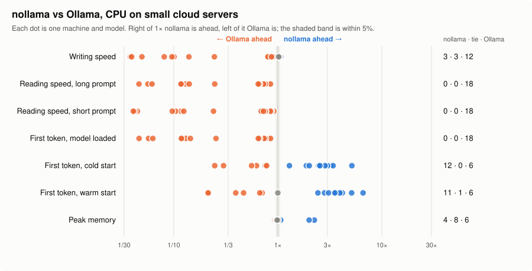
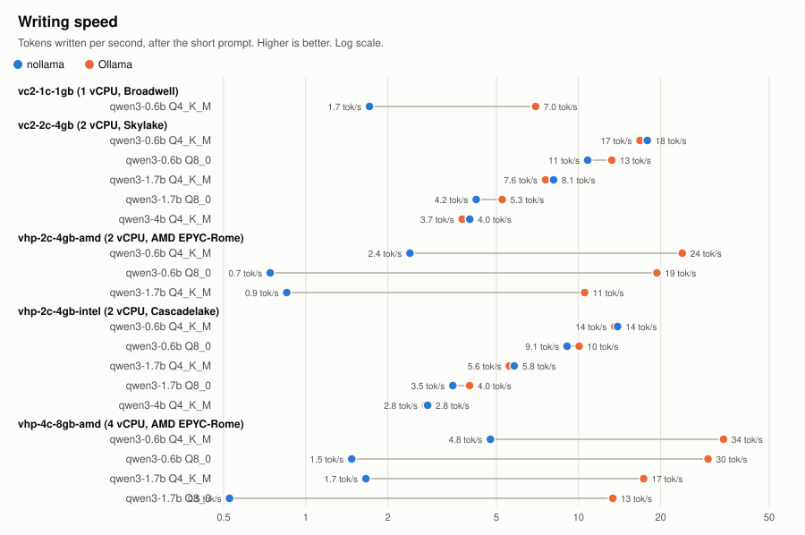
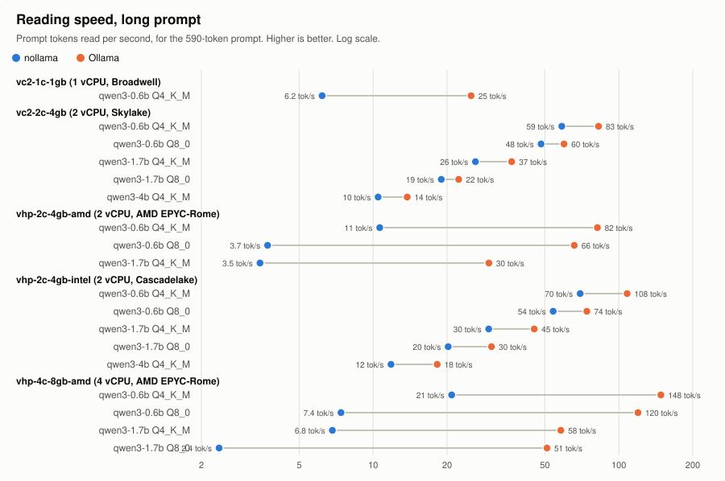
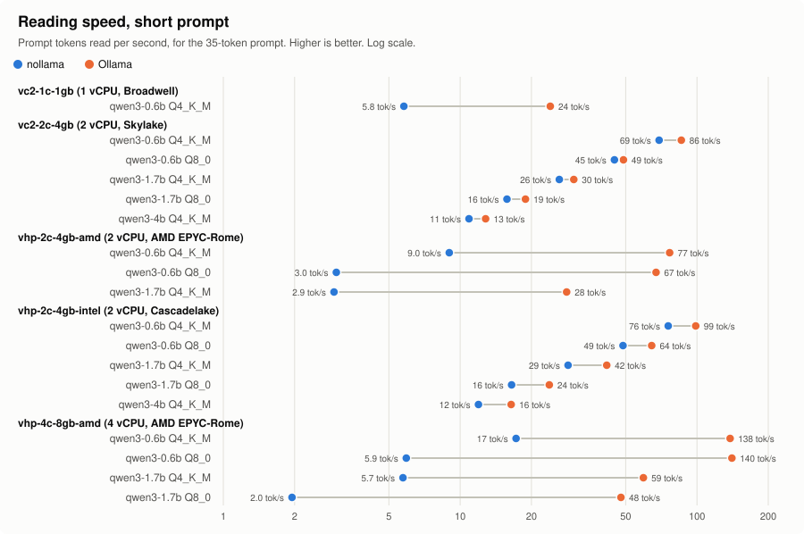
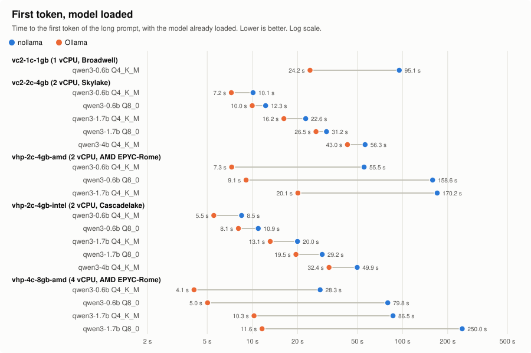
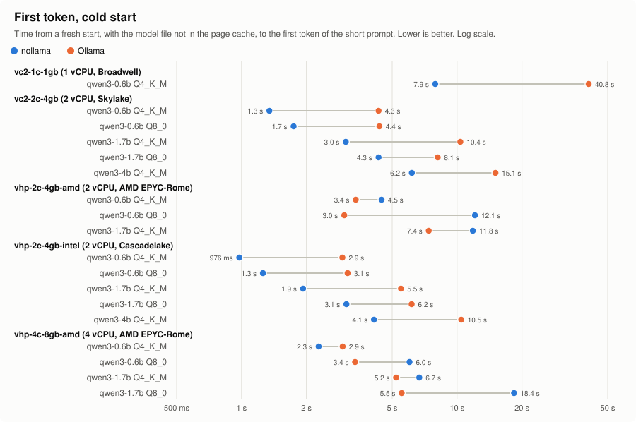
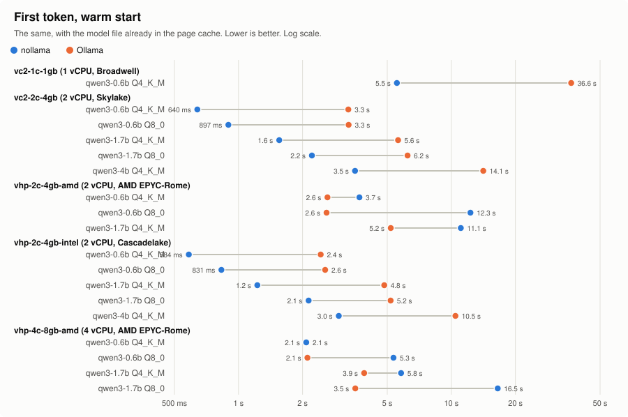
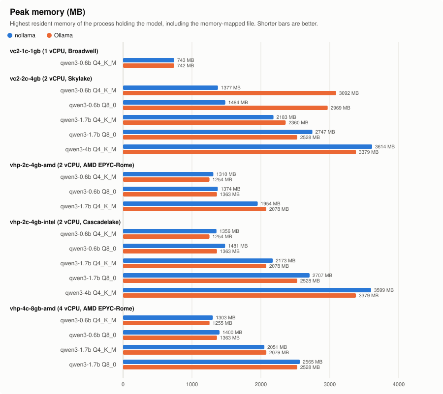

# Benchmarks

This page compares nollama with Ollama, one metric at a time, on the same machines and the same GGUF files. Every
number on it comes from a script, and the raw results are in [`benchmarks/results`](../benchmarks/results), so you can
check them or produce the tables and charts again. In the charts nollama is blue and Ollama is orange. The winner
column in the tables is green where nollama is ahead, red where Ollama is, and yellow where they are within 5% of each
other.



So far the scripted runs cover the CPU on small cloud servers only. Measurements on GPUs (Metal and CUDA) and on
laptops were taken by hand earlier and have been left out until a script produces them the same way.

## How to reproduce

`bench vps` measures one machine and writes a JSON report. With `-ollama` it measures Ollama on the same files the same
way. Run it as root, so that it can drop the page cache before the cold starts:

```bash
go run ./tools/bench vps -models qwen3-0.6b:Q4_K_M=/path/to/model.gguf -ollama -json result.json
```

`tools/bench/vultr/vultr.sh` creates a Vultr server, installs both engines, runs `bench vps` and copies the report
back. `bench report` turns saved reports into the tables and charts on this page:

```bash
go run ./tools/bench report -svg docs/images/benchmarks -img images/benchmarks benchmarks/results/2026-11-21/*.json
```

## Small cloud servers (CPU)

These runs used Qwen3 0.6B, 1.7B and 4B. The Q4_K_M files for 0.6B and 1.7B are Ollama's own (`qwen3:0.6b`,
`qwen3:1.7b`), since Qwen publishes only Q8_0 files at those sizes, and the rest come from Qwen's Hugging Face
repositories. The short prompt is 35 tokens and the long one 590. Bigger models are missing on a machine when their
file did not fit in its memory, and on the AMD EPYC Rome machines when they did not finish within the run's 90
minutes.

On the AMD EPYC Rome and Intel Broadwell machines nollama is far slower than Ollama. nollama runs the same AVX2 code on
all of these machines, so the problem is how that code behaves on those CPU models, and it is a known problem to fix.

Generated by `bench report` from 5 saved `bench vps` runs, one per machine. Each run wrote 128 tokens per measurement and took the median of 3 runs, with one thread per vCPU.

| Machine | CPU | Date | nollama commit | Ollama |
|---|---|---|---|---|
| vc2-1c-1gb (1 vCPU, Broadwell) | Intel Core Processor (Broadwell, no TSX, IBRS) | 2026-11-21 | 0668f344222c | 0.40.17 |
| vc2-2c-4gb (2 vCPU, Skylake) | Intel Xeon Processor (Skylake, IBRS) | 2026-11-21 | 36325534d761 | 0.40.17 |
| vhp-2c-4gb-amd (2 vCPU, AMD EPYC-Rome) | AMD EPYC-Rome Processor | 2026-11-21 | 42876ce7747c | 0.40.17 |
| vhp-2c-4gb-intel (2 vCPU, Cascadelake) | Intel Xeon Processor (Cascadelake) | 2026-11-21 | 42876ce7747c | 0.40.17 |
| vhp-4c-8gb-amd (4 vCPU, AMD EPYC-Rome) | AMD EPYC-Rome Processor | 2026-11-21 | 42876ce7747c | 0.40.17 |

### Writing speed



Tokens written per second, after the short prompt. Higher is better.

| Machine | Model | nollama | Ollama | nollama vs Ollama | Winner |
|---|---|---|---|---|---|
| vc2-1c-1gb (1 vCPU, Broadwell) | qwen3-0.6b Q4_K_M | 1.7 tok/s | 7.0 tok/s | 0.25× | 🔴 Ollama |
| vc2-2c-4gb (2 vCPU, Skylake) | qwen3-0.6b Q4_K_M | 18 tok/s | 17 tok/s | 1.06× | 🟢 nollama |
| vc2-2c-4gb (2 vCPU, Skylake) | qwen3-0.6b Q8_0 | 11 tok/s | 13 tok/s | 0.82× | 🔴 Ollama |
| vc2-2c-4gb (2 vCPU, Skylake) | qwen3-1.7b Q4_K_M | 8.1 tok/s | 7.6 tok/s | 1.07× | 🟢 nollama |
| vc2-2c-4gb (2 vCPU, Skylake) | qwen3-1.7b Q8_0 | 4.2 tok/s | 5.3 tok/s | 0.80× | 🔴 Ollama |
| vc2-2c-4gb (2 vCPU, Skylake) | qwen3-4b Q4_K_M | 4.0 tok/s | 3.7 tok/s | 1.07× | 🟢 nollama |
| vhp-2c-4gb-amd (2 vCPU, AMD EPYC-Rome) | qwen3-0.6b Q4_K_M | 2.4 tok/s | 24 tok/s | 0.10× | 🔴 Ollama |
| vhp-2c-4gb-amd (2 vCPU, AMD EPYC-Rome) | qwen3-0.6b Q8_0 | 0.7 tok/s | 19 tok/s | 0.04× | 🔴 Ollama |
| vhp-2c-4gb-amd (2 vCPU, AMD EPYC-Rome) | qwen3-1.7b Q4_K_M | 0.9 tok/s | 11 tok/s | 0.08× | 🔴 Ollama |
| vhp-2c-4gb-intel (2 vCPU, Cascadelake) | qwen3-0.6b Q4_K_M | 14 tok/s | 14 tok/s | 1.02× | 🟡 tie |
| vhp-2c-4gb-intel (2 vCPU, Cascadelake) | qwen3-0.6b Q8_0 | 9.1 tok/s | 10 tok/s | 0.90× | 🔴 Ollama |
| vhp-2c-4gb-intel (2 vCPU, Cascadelake) | qwen3-1.7b Q4_K_M | 5.8 tok/s | 5.6 tok/s | 1.04× | 🟡 tie |
| vhp-2c-4gb-intel (2 vCPU, Cascadelake) | qwen3-1.7b Q8_0 | 3.5 tok/s | 4.0 tok/s | 0.87× | 🔴 Ollama |
| vhp-2c-4gb-intel (2 vCPU, Cascadelake) | qwen3-4b Q4_K_M | 2.8 tok/s | 2.8 tok/s | 1.02× | 🟡 tie |
| vhp-4c-8gb-amd (4 vCPU, AMD EPYC-Rome) | qwen3-0.6b Q4_K_M | 4.8 tok/s | 34 tok/s | 0.14× | 🔴 Ollama |
| vhp-4c-8gb-amd (4 vCPU, AMD EPYC-Rome) | qwen3-0.6b Q8_0 | 1.5 tok/s | 30 tok/s | 0.05× | 🔴 Ollama |
| vhp-4c-8gb-amd (4 vCPU, AMD EPYC-Rome) | qwen3-1.7b Q4_K_M | 1.7 tok/s | 17 tok/s | 0.10× | 🔴 Ollama |
| vhp-4c-8gb-amd (4 vCPU, AMD EPYC-Rome) | qwen3-1.7b Q8_0 | 0.5 tok/s | 13 tok/s | 0.04× | 🔴 Ollama |

### Reading speed, long prompt



Prompt tokens read per second, for the 590-token prompt. Higher is better.

| Machine | Model | nollama | Ollama | nollama vs Ollama | Winner |
|---|---|---|---|---|---|
| vc2-1c-1gb (1 vCPU, Broadwell) | qwen3-0.6b Q4_K_M | 6.2 tok/s | 25 tok/s | 0.25× | 🔴 Ollama |
| vc2-2c-4gb (2 vCPU, Skylake) | qwen3-0.6b Q4_K_M | 59 tok/s | 83 tok/s | 0.71× | 🔴 Ollama |
| vc2-2c-4gb (2 vCPU, Skylake) | qwen3-0.6b Q8_0 | 48 tok/s | 60 tok/s | 0.81× | 🔴 Ollama |
| vc2-2c-4gb (2 vCPU, Skylake) | qwen3-1.7b Q4_K_M | 26 tok/s | 37 tok/s | 0.71× | 🔴 Ollama |
| vc2-2c-4gb (2 vCPU, Skylake) | qwen3-1.7b Q8_0 | 19 tok/s | 22 tok/s | 0.85× | 🔴 Ollama |
| vc2-2c-4gb (2 vCPU, Skylake) | qwen3-4b Q4_K_M | 10 tok/s | 14 tok/s | 0.76× | 🔴 Ollama |
| vhp-2c-4gb-amd (2 vCPU, AMD EPYC-Rome) | qwen3-0.6b Q4_K_M | 11 tok/s | 82 tok/s | 0.13× | 🔴 Ollama |
| vhp-2c-4gb-amd (2 vCPU, AMD EPYC-Rome) | qwen3-0.6b Q8_0 | 3.7 tok/s | 66 tok/s | 0.06× | 🔴 Ollama |
| vhp-2c-4gb-amd (2 vCPU, AMD EPYC-Rome) | qwen3-1.7b Q4_K_M | 3.5 tok/s | 30 tok/s | 0.12× | 🔴 Ollama |
| vhp-2c-4gb-intel (2 vCPU, Cascadelake) | qwen3-0.6b Q4_K_M | 70 tok/s | 108 tok/s | 0.64× | 🔴 Ollama |
| vhp-2c-4gb-intel (2 vCPU, Cascadelake) | qwen3-0.6b Q8_0 | 54 tok/s | 74 tok/s | 0.73× | 🔴 Ollama |
| vhp-2c-4gb-intel (2 vCPU, Cascadelake) | qwen3-1.7b Q4_K_M | 30 tok/s | 45 tok/s | 0.65× | 🔴 Ollama |
| vhp-2c-4gb-intel (2 vCPU, Cascadelake) | qwen3-1.7b Q8_0 | 20 tok/s | 30 tok/s | 0.67× | 🔴 Ollama |
| vhp-2c-4gb-intel (2 vCPU, Cascadelake) | qwen3-4b Q4_K_M | 12 tok/s | 18 tok/s | 0.65× | 🔴 Ollama |
| vhp-4c-8gb-amd (4 vCPU, AMD EPYC-Rome) | qwen3-0.6b Q4_K_M | 21 tok/s | 148 tok/s | 0.14× | 🔴 Ollama |
| vhp-4c-8gb-amd (4 vCPU, AMD EPYC-Rome) | qwen3-0.6b Q8_0 | 7.4 tok/s | 120 tok/s | 0.06× | 🔴 Ollama |
| vhp-4c-8gb-amd (4 vCPU, AMD EPYC-Rome) | qwen3-1.7b Q4_K_M | 6.8 tok/s | 58 tok/s | 0.12× | 🔴 Ollama |
| vhp-4c-8gb-amd (4 vCPU, AMD EPYC-Rome) | qwen3-1.7b Q8_0 | 2.4 tok/s | 51 tok/s | 0.05× | 🔴 Ollama |

### Reading speed, short prompt



Prompt tokens read per second, for the 35-token prompt. Higher is better.

| Machine | Model | nollama | Ollama | nollama vs Ollama | Winner |
|---|---|---|---|---|---|
| vc2-1c-1gb (1 vCPU, Broadwell) | qwen3-0.6b Q4_K_M | 5.8 tok/s | 24 tok/s | 0.24× | 🔴 Ollama |
| vc2-2c-4gb (2 vCPU, Skylake) | qwen3-0.6b Q4_K_M | 69 tok/s | 86 tok/s | 0.81× | 🔴 Ollama |
| vc2-2c-4gb (2 vCPU, Skylake) | qwen3-0.6b Q8_0 | 45 tok/s | 49 tok/s | 0.92× | 🔴 Ollama |
| vc2-2c-4gb (2 vCPU, Skylake) | qwen3-1.7b Q4_K_M | 26 tok/s | 30 tok/s | 0.87× | 🔴 Ollama |
| vc2-2c-4gb (2 vCPU, Skylake) | qwen3-1.7b Q8_0 | 16 tok/s | 19 tok/s | 0.84× | 🔴 Ollama |
| vc2-2c-4gb (2 vCPU, Skylake) | qwen3-4b Q4_K_M | 11 tok/s | 13 tok/s | 0.85× | 🔴 Ollama |
| vhp-2c-4gb-amd (2 vCPU, AMD EPYC-Rome) | qwen3-0.6b Q4_K_M | 9.0 tok/s | 77 tok/s | 0.12× | 🔴 Ollama |
| vhp-2c-4gb-amd (2 vCPU, AMD EPYC-Rome) | qwen3-0.6b Q8_0 | 3.0 tok/s | 67 tok/s | 0.04× | 🔴 Ollama |
| vhp-2c-4gb-amd (2 vCPU, AMD EPYC-Rome) | qwen3-1.7b Q4_K_M | 2.9 tok/s | 28 tok/s | 0.10× | 🔴 Ollama |
| vhp-2c-4gb-intel (2 vCPU, Cascadelake) | qwen3-0.6b Q4_K_M | 76 tok/s | 99 tok/s | 0.76× | 🔴 Ollama |
| vhp-2c-4gb-intel (2 vCPU, Cascadelake) | qwen3-0.6b Q8_0 | 49 tok/s | 64 tok/s | 0.76× | 🔴 Ollama |
| vhp-2c-4gb-intel (2 vCPU, Cascadelake) | qwen3-1.7b Q4_K_M | 29 tok/s | 42 tok/s | 0.69× | 🔴 Ollama |
| vhp-2c-4gb-intel (2 vCPU, Cascadelake) | qwen3-1.7b Q8_0 | 16 tok/s | 24 tok/s | 0.69× | 🔴 Ollama |
| vhp-2c-4gb-intel (2 vCPU, Cascadelake) | qwen3-4b Q4_K_M | 12 tok/s | 16 tok/s | 0.73× | 🔴 Ollama |
| vhp-4c-8gb-amd (4 vCPU, AMD EPYC-Rome) | qwen3-0.6b Q4_K_M | 17 tok/s | 138 tok/s | 0.12× | 🔴 Ollama |
| vhp-4c-8gb-amd (4 vCPU, AMD EPYC-Rome) | qwen3-0.6b Q8_0 | 5.9 tok/s | 140 tok/s | 0.04× | 🔴 Ollama |
| vhp-4c-8gb-amd (4 vCPU, AMD EPYC-Rome) | qwen3-1.7b Q4_K_M | 5.7 tok/s | 59 tok/s | 0.10× | 🔴 Ollama |
| vhp-4c-8gb-amd (4 vCPU, AMD EPYC-Rome) | qwen3-1.7b Q8_0 | 2.0 tok/s | 48 tok/s | 0.04× | 🔴 Ollama |

### First token, model loaded



Time to the first token of the long prompt, with the model already loaded. Lower is better.

| Machine | Model | nollama | Ollama | nollama vs Ollama | Winner |
|---|---|---|---|---|---|
| vc2-1c-1gb (1 vCPU, Broadwell) | qwen3-0.6b Q4_K_M | 95.1 s | 24.2 s | 0.25× | 🔴 Ollama |
| vc2-2c-4gb (2 vCPU, Skylake) | qwen3-0.6b Q4_K_M | 10.1 s | 7.2 s | 0.72× | 🔴 Ollama |
| vc2-2c-4gb (2 vCPU, Skylake) | qwen3-0.6b Q8_0 | 12.3 s | 10.0 s | 0.81× | 🔴 Ollama |
| vc2-2c-4gb (2 vCPU, Skylake) | qwen3-1.7b Q4_K_M | 22.6 s | 16.2 s | 0.72× | 🔴 Ollama |
| vc2-2c-4gb (2 vCPU, Skylake) | qwen3-1.7b Q8_0 | 31.2 s | 26.5 s | 0.85× | 🔴 Ollama |
| vc2-2c-4gb (2 vCPU, Skylake) | qwen3-4b Q4_K_M | 56.3 s | 43.0 s | 0.76× | 🔴 Ollama |
| vhp-2c-4gb-amd (2 vCPU, AMD EPYC-Rome) | qwen3-0.6b Q4_K_M | 55.5 s | 7.3 s | 0.13× | 🔴 Ollama |
| vhp-2c-4gb-amd (2 vCPU, AMD EPYC-Rome) | qwen3-0.6b Q8_0 | 158.6 s | 9.1 s | 0.06× | 🔴 Ollama |
| vhp-2c-4gb-amd (2 vCPU, AMD EPYC-Rome) | qwen3-1.7b Q4_K_M | 170.2 s | 20.1 s | 0.12× | 🔴 Ollama |
| vhp-2c-4gb-intel (2 vCPU, Cascadelake) | qwen3-0.6b Q4_K_M | 8.5 s | 5.5 s | 0.65× | 🔴 Ollama |
| vhp-2c-4gb-intel (2 vCPU, Cascadelake) | qwen3-0.6b Q8_0 | 10.9 s | 8.1 s | 0.74× | 🔴 Ollama |
| vhp-2c-4gb-intel (2 vCPU, Cascadelake) | qwen3-1.7b Q4_K_M | 20.0 s | 13.1 s | 0.66× | 🔴 Ollama |
| vhp-2c-4gb-intel (2 vCPU, Cascadelake) | qwen3-1.7b Q8_0 | 29.2 s | 19.5 s | 0.67× | 🔴 Ollama |
| vhp-2c-4gb-intel (2 vCPU, Cascadelake) | qwen3-4b Q4_K_M | 49.9 s | 32.4 s | 0.65× | 🔴 Ollama |
| vhp-4c-8gb-amd (4 vCPU, AMD EPYC-Rome) | qwen3-0.6b Q4_K_M | 28.3 s | 4.1 s | 0.14× | 🔴 Ollama |
| vhp-4c-8gb-amd (4 vCPU, AMD EPYC-Rome) | qwen3-0.6b Q8_0 | 79.8 s | 5.0 s | 0.06× | 🔴 Ollama |
| vhp-4c-8gb-amd (4 vCPU, AMD EPYC-Rome) | qwen3-1.7b Q4_K_M | 86.5 s | 10.3 s | 0.12× | 🔴 Ollama |
| vhp-4c-8gb-amd (4 vCPU, AMD EPYC-Rome) | qwen3-1.7b Q8_0 | 250.0 s | 11.6 s | 0.05× | 🔴 Ollama |

### First token, cold start



Time from a fresh start, with the model file not in the page cache, to the first token of the short prompt. Lower is better.

| Machine | Model | nollama | Ollama | nollama vs Ollama | Winner |
|---|---|---|---|---|---|
| vc2-1c-1gb (1 vCPU, Broadwell) | qwen3-0.6b Q4_K_M | 7.9 s | 40.8 s | 5.15× | 🟢 nollama |
| vc2-2c-4gb (2 vCPU, Skylake) | qwen3-0.6b Q4_K_M | 1.3 s | 4.3 s | 3.21× | 🟢 nollama |
| vc2-2c-4gb (2 vCPU, Skylake) | qwen3-0.6b Q8_0 | 1.7 s | 4.4 s | 2.50× | 🟢 nollama |
| vc2-2c-4gb (2 vCPU, Skylake) | qwen3-1.7b Q4_K_M | 3.0 s | 10.4 s | 3.40× | 🟢 nollama |
| vc2-2c-4gb (2 vCPU, Skylake) | qwen3-1.7b Q8_0 | 4.3 s | 8.1 s | 1.88× | 🟢 nollama |
| vc2-2c-4gb (2 vCPU, Skylake) | qwen3-4b Q4_K_M | 6.2 s | 15.1 s | 2.44× | 🟢 nollama |
| vhp-2c-4gb-amd (2 vCPU, AMD EPYC-Rome) | qwen3-0.6b Q4_K_M | 4.5 s | 3.4 s | 0.76× | 🔴 Ollama |
| vhp-2c-4gb-amd (2 vCPU, AMD EPYC-Rome) | qwen3-0.6b Q8_0 | 12.1 s | 3.0 s | 0.25× | 🔴 Ollama |
| vhp-2c-4gb-amd (2 vCPU, AMD EPYC-Rome) | qwen3-1.7b Q4_K_M | 11.8 s | 7.4 s | 0.62× | 🔴 Ollama |
| vhp-2c-4gb-intel (2 vCPU, Cascadelake) | qwen3-0.6b Q4_K_M | 976 ms | 2.9 s | 3.01× | 🟢 nollama |
| vhp-2c-4gb-intel (2 vCPU, Cascadelake) | qwen3-0.6b Q8_0 | 1.3 s | 3.1 s | 2.47× | 🟢 nollama |
| vhp-2c-4gb-intel (2 vCPU, Cascadelake) | qwen3-1.7b Q4_K_M | 1.9 s | 5.5 s | 2.85× | 🟢 nollama |
| vhp-2c-4gb-intel (2 vCPU, Cascadelake) | qwen3-1.7b Q8_0 | 3.1 s | 6.2 s | 2.01× | 🟢 nollama |
| vhp-2c-4gb-intel (2 vCPU, Cascadelake) | qwen3-4b Q4_K_M | 4.1 s | 10.5 s | 2.54× | 🟢 nollama |
| vhp-4c-8gb-amd (4 vCPU, AMD EPYC-Rome) | qwen3-0.6b Q4_K_M | 2.3 s | 2.9 s | 1.29× | 🟢 nollama |
| vhp-4c-8gb-amd (4 vCPU, AMD EPYC-Rome) | qwen3-0.6b Q8_0 | 6.0 s | 3.4 s | 0.56× | 🔴 Ollama |
| vhp-4c-8gb-amd (4 vCPU, AMD EPYC-Rome) | qwen3-1.7b Q4_K_M | 6.7 s | 5.2 s | 0.78× | 🔴 Ollama |
| vhp-4c-8gb-amd (4 vCPU, AMD EPYC-Rome) | qwen3-1.7b Q8_0 | 18.4 s | 5.5 s | 0.30× | 🔴 Ollama |

### First token, warm start



The same, with the model file already in the page cache. Lower is better.

| Machine | Model | nollama | Ollama | nollama vs Ollama | Winner |
|---|---|---|---|---|---|
| vc2-1c-1gb (1 vCPU, Broadwell) | qwen3-0.6b Q4_K_M | 5.5 s | 36.6 s | 6.59× | 🟢 nollama |
| vc2-2c-4gb (2 vCPU, Skylake) | qwen3-0.6b Q4_K_M | 640 ms | 3.3 s | 5.12× | 🟢 nollama |
| vc2-2c-4gb (2 vCPU, Skylake) | qwen3-0.6b Q8_0 | 897 ms | 3.3 s | 3.67× | 🟢 nollama |
| vc2-2c-4gb (2 vCPU, Skylake) | qwen3-1.7b Q4_K_M | 1.6 s | 5.6 s | 3.62× | 🟢 nollama |
| vc2-2c-4gb (2 vCPU, Skylake) | qwen3-1.7b Q8_0 | 2.2 s | 6.2 s | 2.82× | 🟢 nollama |
| vc2-2c-4gb (2 vCPU, Skylake) | qwen3-4b Q4_K_M | 3.5 s | 14.1 s | 4.00× | 🟢 nollama |
| vhp-2c-4gb-amd (2 vCPU, AMD EPYC-Rome) | qwen3-0.6b Q4_K_M | 3.7 s | 2.6 s | 0.71× | 🔴 Ollama |
| vhp-2c-4gb-amd (2 vCPU, AMD EPYC-Rome) | qwen3-0.6b Q8_0 | 12.3 s | 2.6 s | 0.21× | 🔴 Ollama |
| vhp-2c-4gb-amd (2 vCPU, AMD EPYC-Rome) | qwen3-1.7b Q4_K_M | 11.1 s | 5.2 s | 0.47× | 🔴 Ollama |
| vhp-2c-4gb-intel (2 vCPU, Cascadelake) | qwen3-0.6b Q4_K_M | 584 ms | 2.4 s | 4.17× | 🟢 nollama |
| vhp-2c-4gb-intel (2 vCPU, Cascadelake) | qwen3-0.6b Q8_0 | 831 ms | 2.6 s | 3.07× | 🟢 nollama |
| vhp-2c-4gb-intel (2 vCPU, Cascadelake) | qwen3-1.7b Q4_K_M | 1.2 s | 4.8 s | 3.95× | 🟢 nollama |
| vhp-2c-4gb-intel (2 vCPU, Cascadelake) | qwen3-1.7b Q8_0 | 2.1 s | 5.2 s | 2.43× | 🟢 nollama |
| vhp-2c-4gb-intel (2 vCPU, Cascadelake) | qwen3-4b Q4_K_M | 3.0 s | 10.5 s | 3.53× | 🟢 nollama |
| vhp-4c-8gb-amd (4 vCPU, AMD EPYC-Rome) | qwen3-0.6b Q4_K_M | 2.1 s | 2.1 s | 1.00× | 🟡 tie |
| vhp-4c-8gb-amd (4 vCPU, AMD EPYC-Rome) | qwen3-0.6b Q8_0 | 5.3 s | 2.1 s | 0.39× | 🔴 Ollama |
| vhp-4c-8gb-amd (4 vCPU, AMD EPYC-Rome) | qwen3-1.7b Q4_K_M | 5.8 s | 3.9 s | 0.67× | 🔴 Ollama |
| vhp-4c-8gb-amd (4 vCPU, AMD EPYC-Rome) | qwen3-1.7b Q8_0 | 16.5 s | 3.5 s | 0.21× | 🔴 Ollama |

### Peak memory



Highest resident memory of the process holding the model, including the memory-mapped file. Lower is better.

| Machine | Model | nollama | Ollama | nollama vs Ollama | Winner |
|---|---|---|---|---|---|
| vc2-1c-1gb (1 vCPU, Broadwell) | qwen3-0.6b Q4_K_M | 743 MB | 742 MB | 1.00× | 🟡 tie |
| vc2-2c-4gb (2 vCPU, Skylake) | qwen3-0.6b Q4_K_M | 1377 MB | 3092 MB | 2.25× | 🟢 nollama |
| vc2-2c-4gb (2 vCPU, Skylake) | qwen3-0.6b Q8_0 | 1484 MB | 2969 MB | 2.00× | 🟢 nollama |
| vc2-2c-4gb (2 vCPU, Skylake) | qwen3-1.7b Q4_K_M | 2183 MB | 2360 MB | 1.08× | 🟢 nollama |
| vc2-2c-4gb (2 vCPU, Skylake) | qwen3-1.7b Q8_0 | 2747 MB | 2528 MB | 0.92× | 🔴 Ollama |
| vc2-2c-4gb (2 vCPU, Skylake) | qwen3-4b Q4_K_M | 3614 MB | 3379 MB | 0.93× | 🔴 Ollama |
| vhp-2c-4gb-amd (2 vCPU, AMD EPYC-Rome) | qwen3-0.6b Q4_K_M | 1310 MB | 1254 MB | 0.96× | 🟡 tie |
| vhp-2c-4gb-amd (2 vCPU, AMD EPYC-Rome) | qwen3-0.6b Q8_0 | 1374 MB | 1363 MB | 0.99× | 🟡 tie |
| vhp-2c-4gb-amd (2 vCPU, AMD EPYC-Rome) | qwen3-1.7b Q4_K_M | 1954 MB | 2078 MB | 1.06× | 🟢 nollama |
| vhp-2c-4gb-intel (2 vCPU, Cascadelake) | qwen3-0.6b Q4_K_M | 1356 MB | 1254 MB | 0.92× | 🔴 Ollama |
| vhp-2c-4gb-intel (2 vCPU, Cascadelake) | qwen3-0.6b Q8_0 | 1481 MB | 1363 MB | 0.92× | 🔴 Ollama |
| vhp-2c-4gb-intel (2 vCPU, Cascadelake) | qwen3-1.7b Q4_K_M | 2173 MB | 2078 MB | 0.96× | 🟡 tie |
| vhp-2c-4gb-intel (2 vCPU, Cascadelake) | qwen3-1.7b Q8_0 | 2707 MB | 2528 MB | 0.93× | 🔴 Ollama |
| vhp-2c-4gb-intel (2 vCPU, Cascadelake) | qwen3-4b Q4_K_M | 3599 MB | 3379 MB | 0.94× | 🔴 Ollama |
| vhp-4c-8gb-amd (4 vCPU, AMD EPYC-Rome) | qwen3-0.6b Q4_K_M | 1303 MB | 1255 MB | 0.96× | 🟡 tie |
| vhp-4c-8gb-amd (4 vCPU, AMD EPYC-Rome) | qwen3-0.6b Q8_0 | 1400 MB | 1363 MB | 0.97× | 🟡 tie |
| vhp-4c-8gb-amd (4 vCPU, AMD EPYC-Rome) | qwen3-1.7b Q4_K_M | 2051 MB | 2079 MB | 1.01× | 🟡 tie |
| vhp-4c-8gb-amd (4 vCPU, AMD EPYC-Rome) | qwen3-1.7b Q8_0 | 2565 MB | 2528 MB | 0.99× | 🟡 tie |

